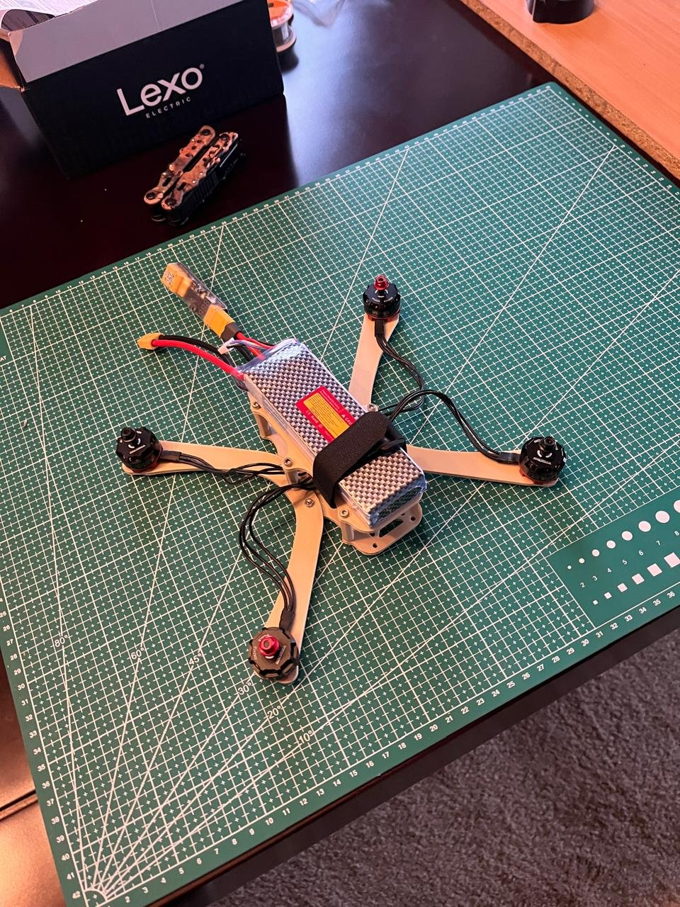
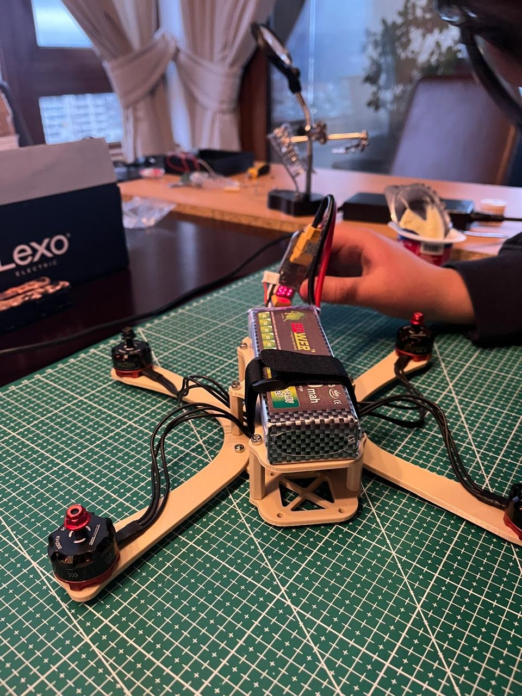
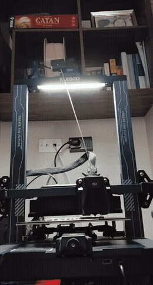
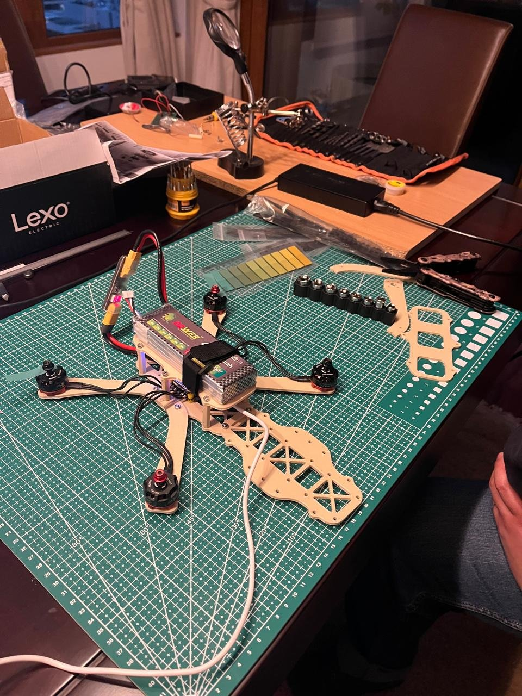
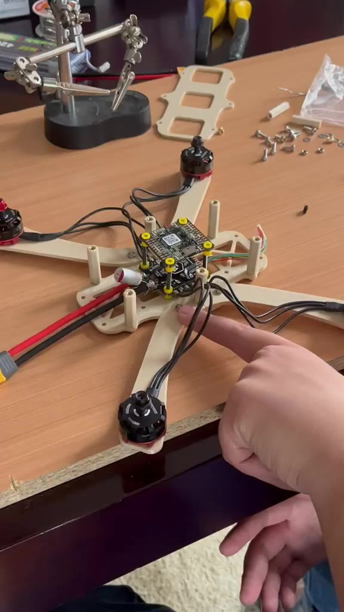
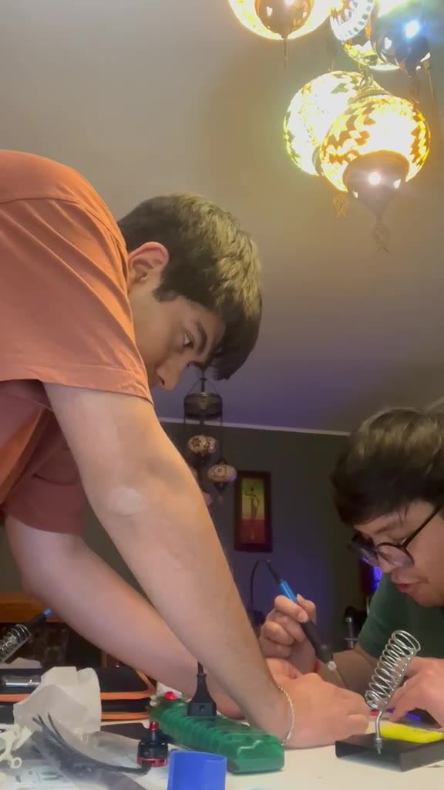
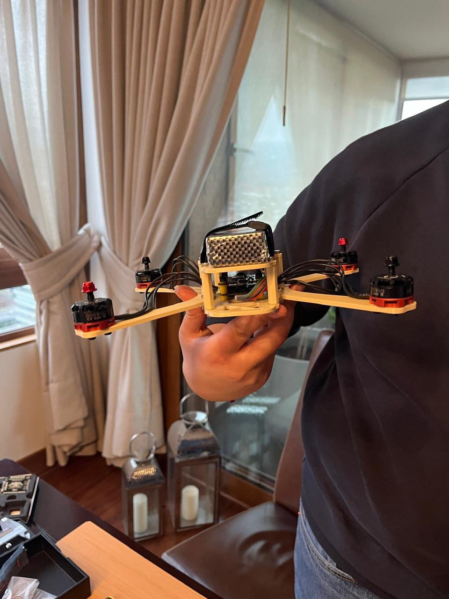

# 🚁 3D-Printed FPV Quadcopter

A quadcopter built from scratch with a friend: custom frame designed in **Autodesk Inventor**, printed in **PETG**, and controlled by a **SpeedyBee F405 V4** stack running **Betaflight**. The current frame is the **third design iteration**.

  
  

## 📍 Status

| Stage | Status |
|---|---|
| Frame design (3 iterations) | ✅ Done |
| Printing and assembly | ✅ Done |
| Electronics, soldering and wiring | ✅ Done |
| Betaflight configuration, motor tests and PID setup | ✅ Done |
| First flight | ⏳ Coming soon |

## 🧩 Hardware

| Component | Choice |
|---|---|
| Frame | Custom design, Autodesk Inventor, printed in Rapid PETG |
| Flight controller + ESC | SpeedyBee F405 V4 stack |
| Firmware | Betaflight |
| Camera | None yet |

> 📋 The full bill of materials will be added soon.

## 🛠️ Design and Build

We started from frame designs we found online and then adapted them to our components. The frame was printed in **Rapid PETG**, which is tougher and more heat resistant than PLA, so it holds up better to crashes and to the heat from the electronics.

  
  
  

  
  

## 🔁 What Changed Across the Three Iterations

Most of the engineering in this project was in the details that only show up once you try to assemble real parts:

| Problem | Fix |
|---|---|
| **Propellers didn't fit** in the original design | Reworked the arm geometry to give the propellers enough clearance |
| **Battery mounting** | Designed a dedicated battery bay, tuning dimensions and print tolerances for a snug fit |
| **Stack overheating risk** | Adjusted the geometry around the flight controller and ESC to leave room for airflow |
| **Loose cables** | Added holes in the arms for cable straps |
| **Cables bending sharply** at the motors and the battery lead | Resized passages and mounting points so wires run without tight bends |

## 📚 What I Learned

- Designing for **3D printing**: tolerances, wall thickness and orientation matter as much as the nominal CAD dimensions
- **Integration** is the hard part: the frame has to work around propellers, battery, stack, wiring and cooling at the same time
- Setting up **Betaflight**: motor tests and PID setup

## 🔜 Next Steps

- First flight and PID tuning in the air
- Possibly add an FPV camera and video transmitter
- Publish the CAD files and the bill of materials

## 🧰 Tools

